# NovaOS

**NovaOS 1.5 Developer Preview** - a hobby operating system with a modern
graphical desktop, written from scratch in C and assembly.

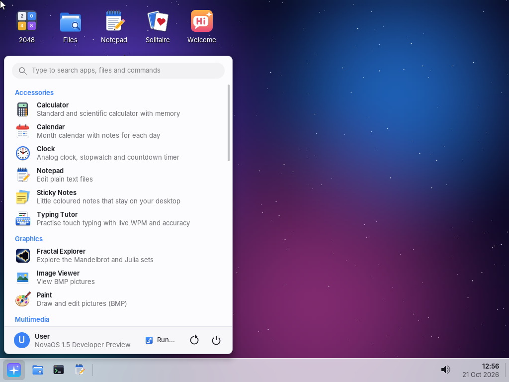

NovaOS is a small 32-bit x86 operating system. Nothing in it comes from Linux,
BSD or any other OS: the kernel, drivers, window manager, widget toolkit,
font renderer, icons and all 30 apps are freestanding C and NASM written for
this project. It boots from a CD image (via GRUB) straight into a desktop with
windows, a taskbar, a Start menu, background services and apps, and runs in
**VirtualBox** and QEMU. The **Installer** app copies it onto a virtual hard
disk, which then boots NovaOS on its own and keeps your files across
restarts.

**Download:** [`NovaOS.iso`](NovaOS.iso) in this repository (about 10 MB).
See [RELEASE_NOTES.md](RELEASE_NOTES.md) for what is new in 1.5.

> **Developer Preview:** NovaOS is a hobby project and a technology preview.
> It has been tested in QEMU, which emulates the same hardware VirtualBox
> does, but **not yet on real VirtualBox or real PCs** - see
> [Known limitations](#known-limitations). Use it in a virtual machine.

## Contents

* [Screenshots](#screenshots)
* [Features](#features)
* [The apps](#the-apps)
* [Running NovaOS in VirtualBox (step by step)](#running-novaos-in-virtualbox-step-by-step)
* [Running in QEMU](#running-in-qemu)
* [Using NovaOS](#using-novaos)
* [Keyboard shortcuts](#keyboard-shortcuts)
* [Building from source](#building-from-source)
* [Known limitations](#known-limitations)
* [Repository layout](#repository-layout)
* [Built with Claude](#built-with-claude)

## Screenshots

Every app in NovaOS 1.5 (each one screenshotted in QEMU from the release build):

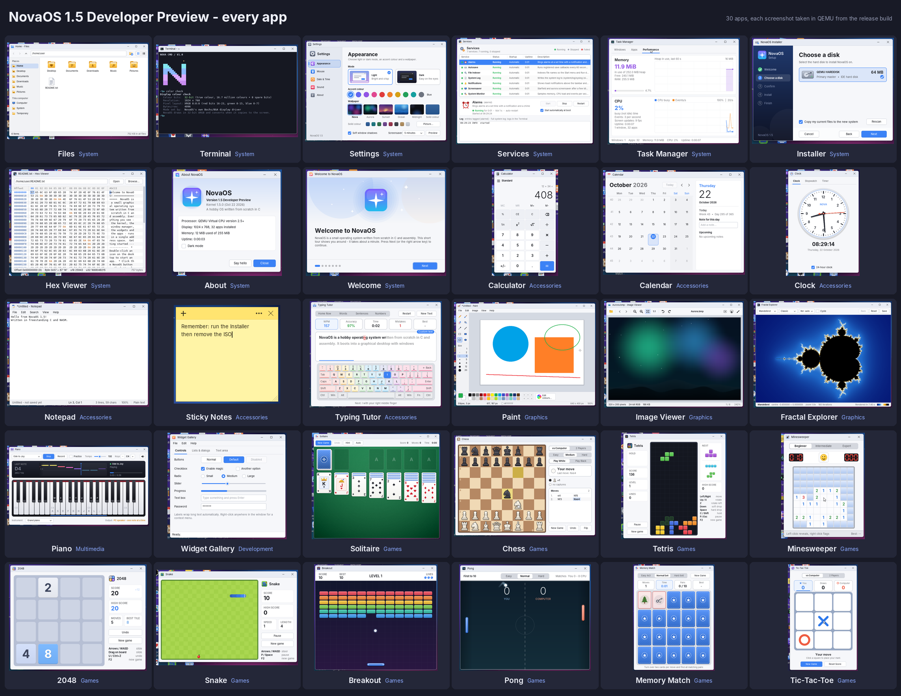

| | |
|---|---|
|  | 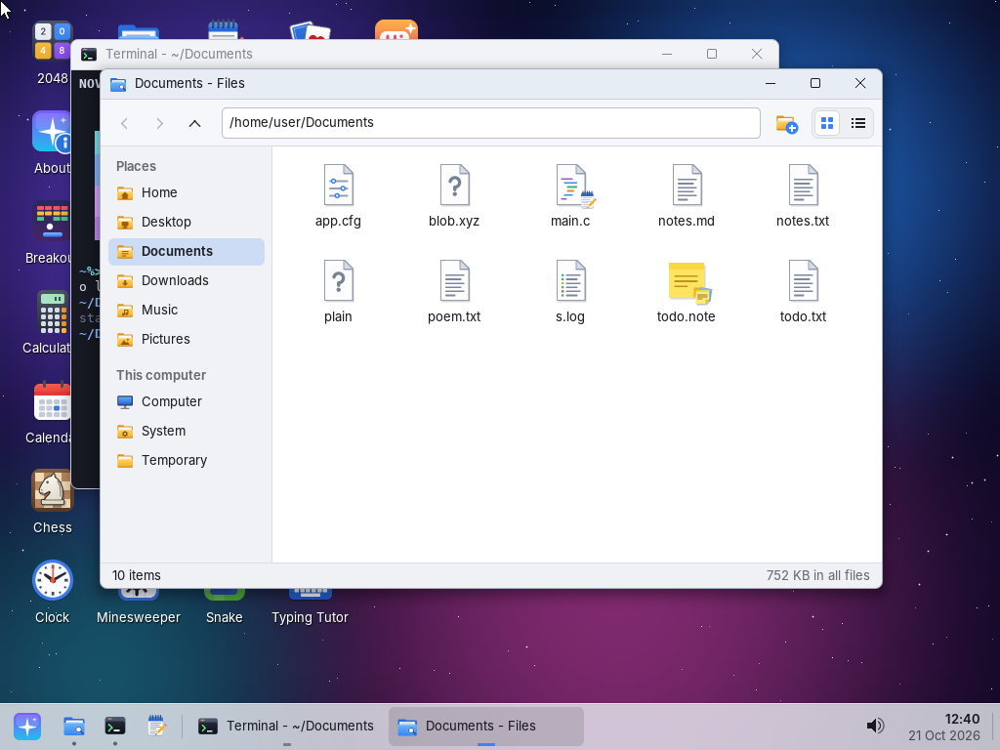 |
| **Terminal** - the NOVA CMD banner and `color check` | **Files** - file-type icons, default-app badges, places |
| 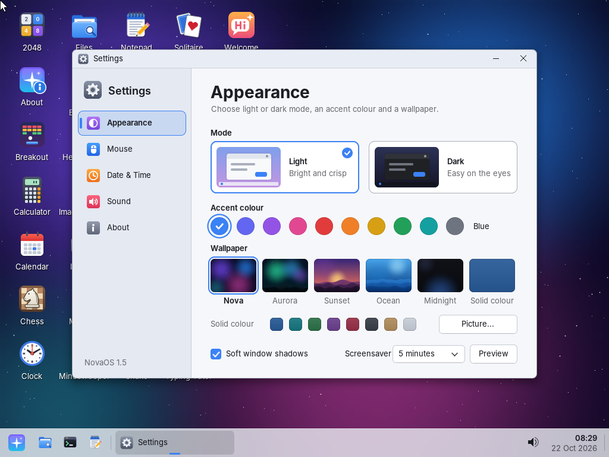 | 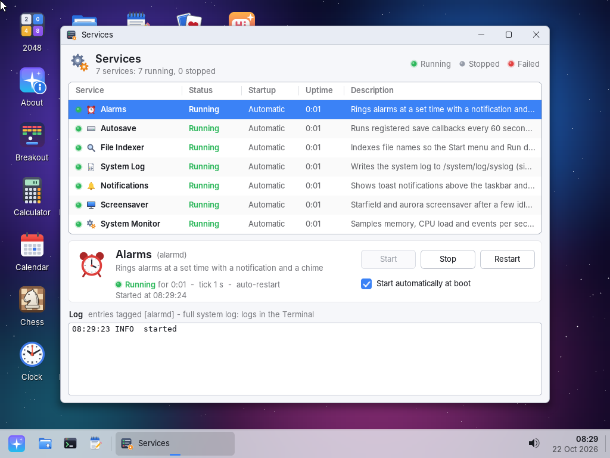 |
| **Settings** - light / dark mode, accent colours, wallpapers | **Services** - background services with status and logs |
| 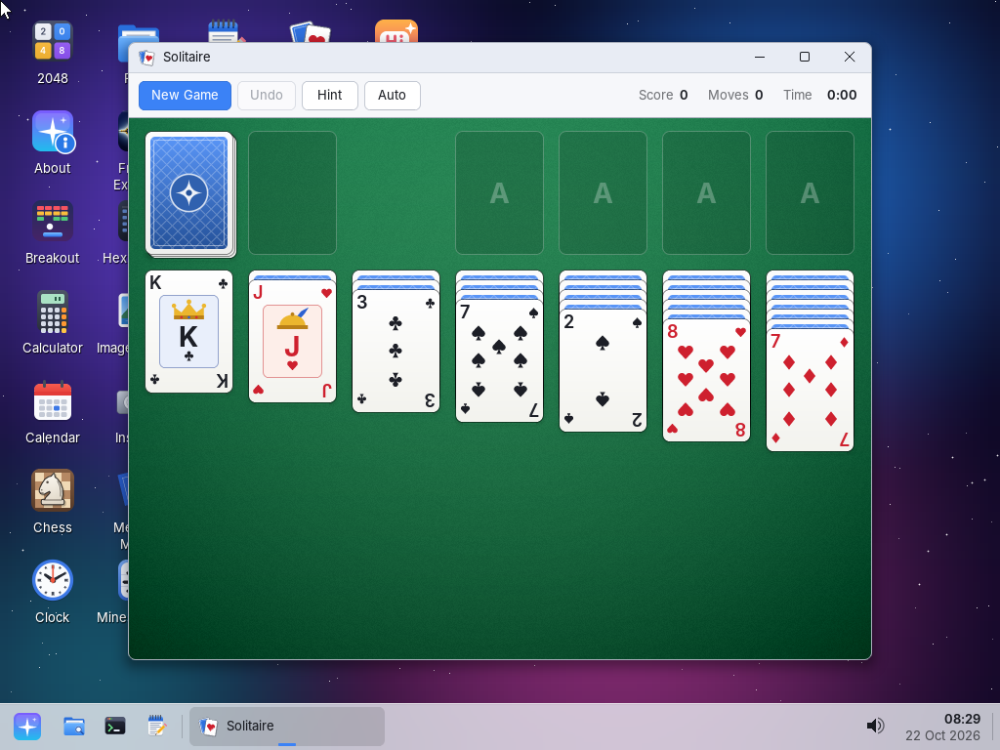 | 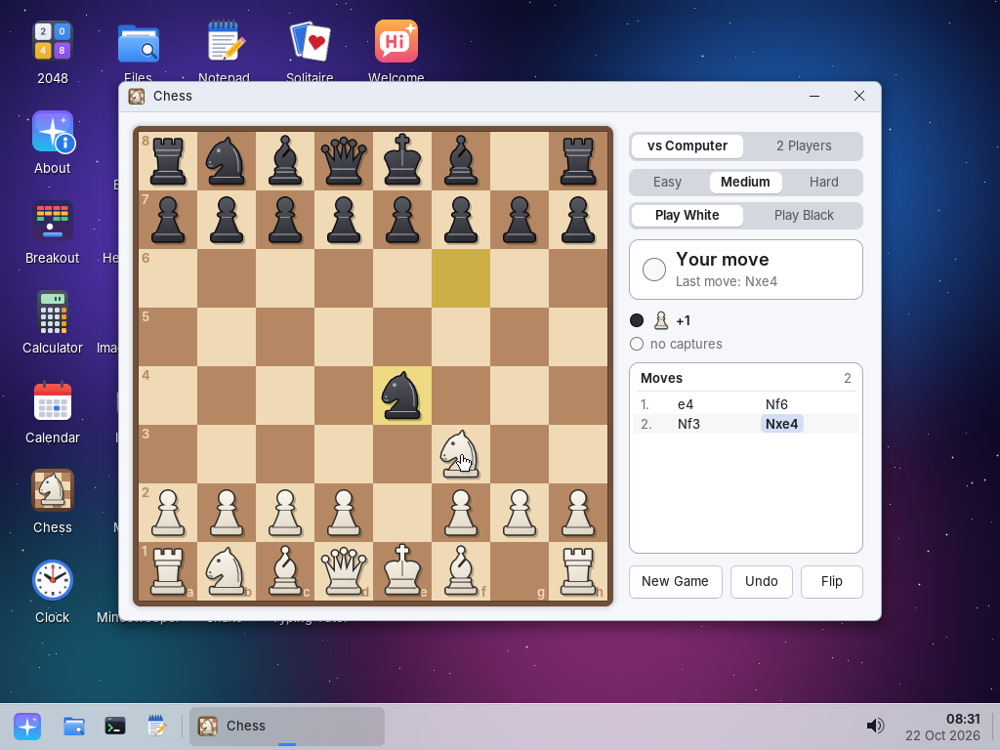 |
| **Solitaire** - Klondike with drag and drop | **Chess** - full rules against the computer |
| 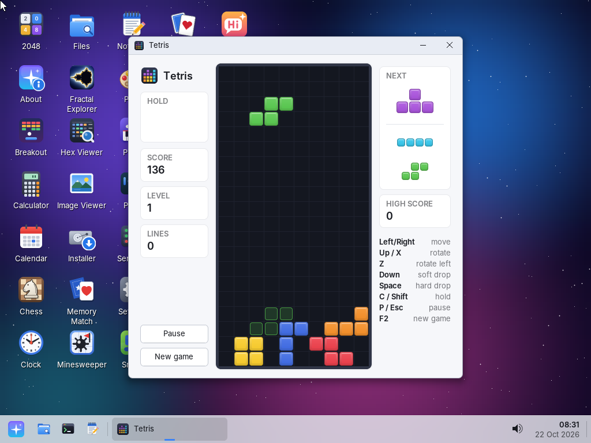 | 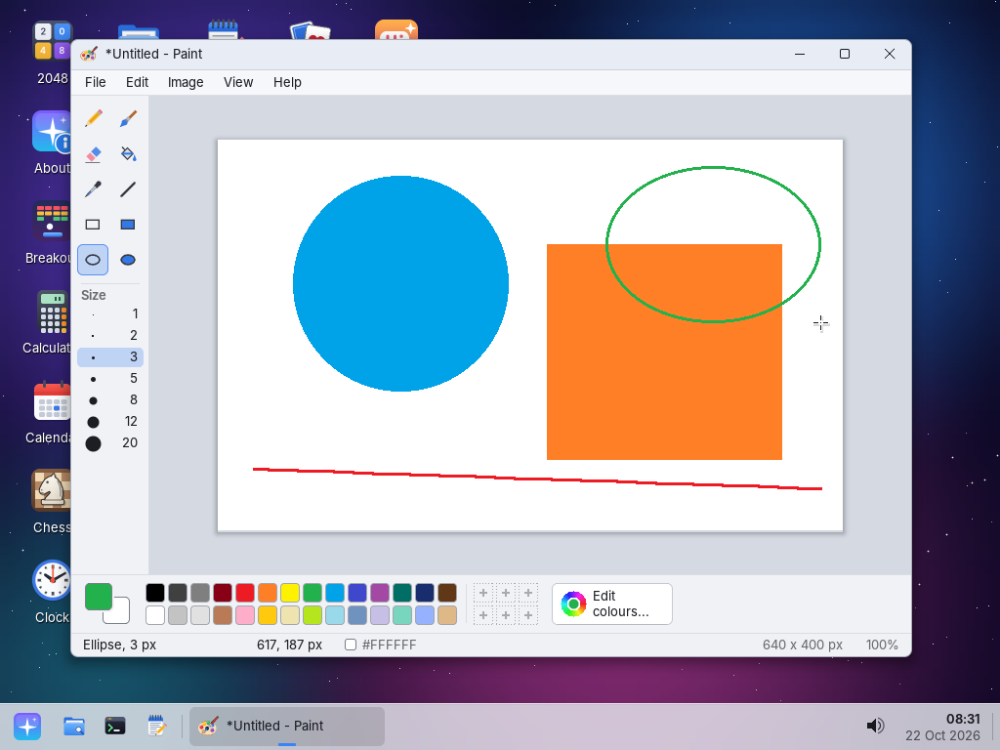 |
| **Tetris** | **Paint** - brushes, shapes, fill, palette, BMP files |
| 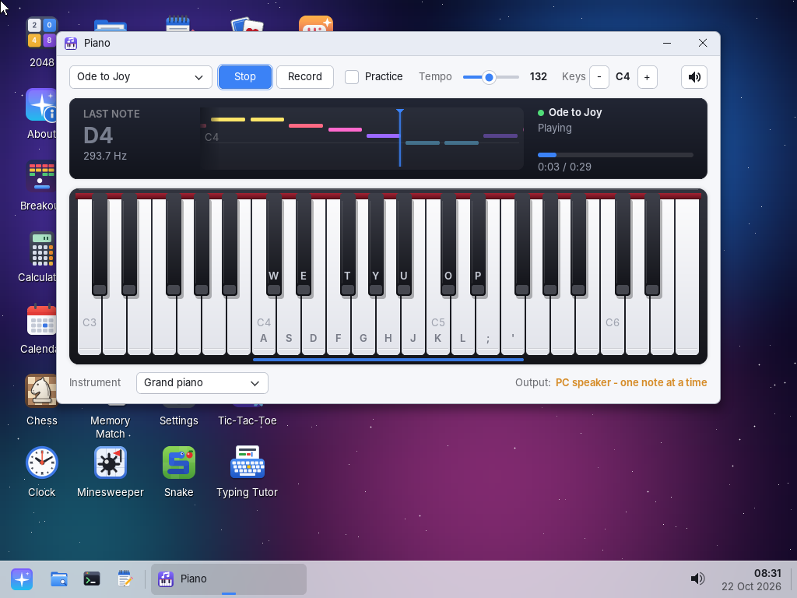 | 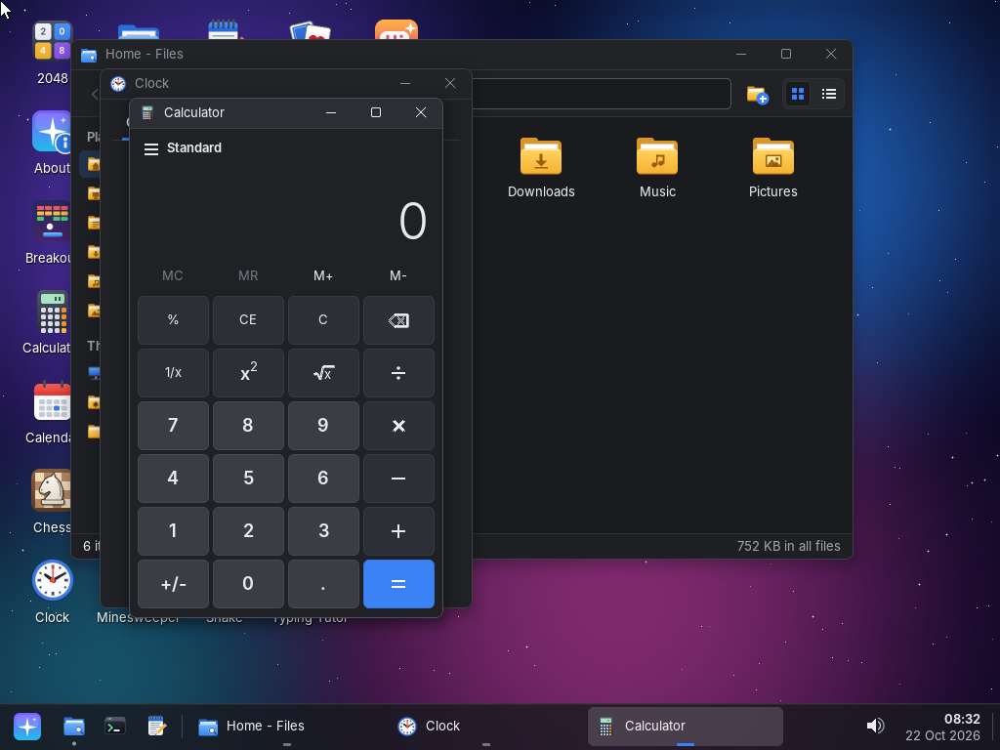 |
| **Piano** - playing a song with a piano roll | Dark theme with overlapping windows |
|  | 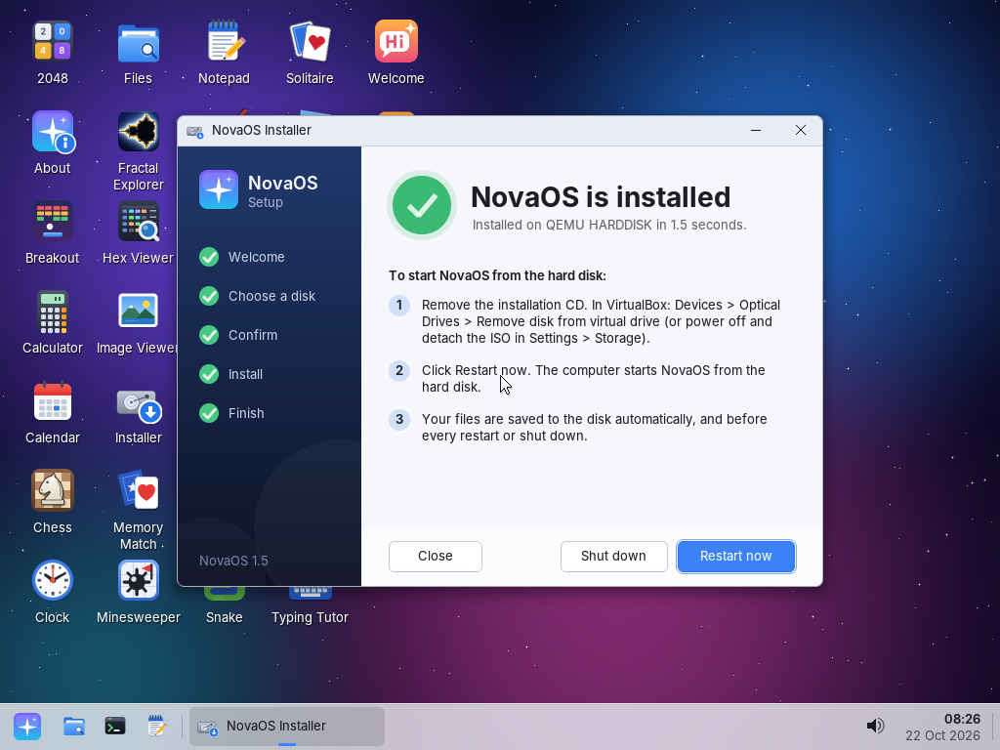 |
| **Installer** - choosing the hard disk | Installation finished |
| 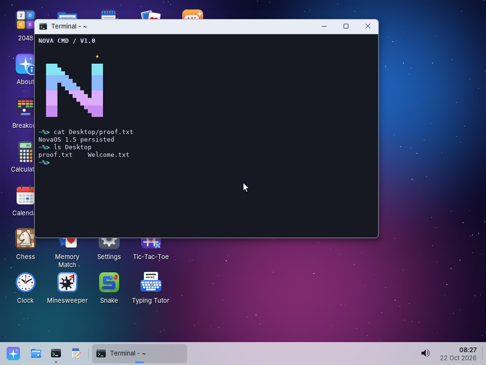 | 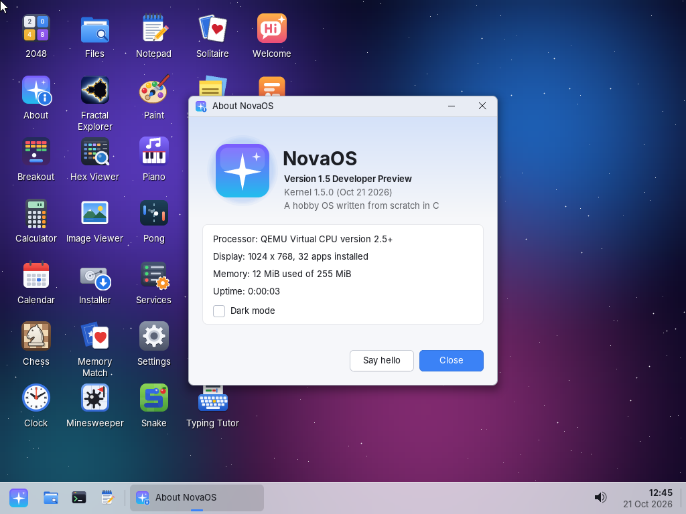 |
| Booted from the installed disk: a file written before the restart is still there | **About** |

## Features

**Desktop**

* VBE linear framebuffer, 1024x768 in 32-bit colour by default (800x600
  safe mode, 24-bit modes, Bochs/BGA fallback)
* Double-buffered compositor with dirty rectangles, anti-aliased fonts
  (Inter + DejaVu Sans Mono), rounded windows and soft drop shadows
* Window manager: move, resize, maximize, minimize, snap to screen edges,
  Alt+Tab, z-order, focus
* Taskbar with pinned apps, window buttons, volume icon, live clock and
  calendar; Start menu with categories, recent items and search over apps,
  files and commands; Run dialog (Win+R) with autocomplete
* Desktop icons for apps and files, desktop context menus (Open / Open With
  / Rename / Delete / Properties, New Folder / New Text File, wallpaper, dark
  mode), boot splash, first-run Welcome tour
* Light and dark themes, accent colours, procedural wallpapers
* Hand-drawn icon library (apps, folders, file types, devices, status icons)
  tuned for 16, 32 and 48 px - every icon is drawn by NovaOS code, no image
  files, no emoji
* Widget toolkit: buttons, labels, text boxes, checkboxes, radio buttons,
  sliders, progress bars, list boxes, scroll bars, dropdowns, tabs, menu bars,
  context menus, message / input / file dialogs, notifications
* File associations with user-changeable defaults, Open With and Properties
  dialogs, taskbar pinning

**System**

* 32-bit x86 protected-mode kernel booted by GRUB (Multiboot 1) from the CD,
  or by NovaOS's own two-stage boot loader from an installed hard disk
* Background services run by a service manager (autostart, restart on
  failure, per-service logs, system log in `/system/log/syslog`):
  notifications, screensaver (starfield + aurora), alarms, autosave, file
  indexer, system monitor
* Heap allocator, in-memory hierarchical file system, libc / libm subset,
  kernel panic screen with symbolised stack traces
* Installer wizard and automatic saving of all files to the installed disk
  (two save slots, so a power cut never damages the last good save)
* ACPI power off, ACPI power button (VirtualBox *ACPI Shutdown* shuts NovaOS
  down cleanly), reboot

**Drivers**

* PS/2 keyboard (US layout, Caps / Num / Scroll Lock LEDs) and PS/2 mouse
  with scroll wheel
* ATA PIO hard disks: IDE primary / secondary, master / slave, LBA28 / LBA48
* Sound: Intel ICH AC'97 and Sound Blaster 16 with an 8-voice software
  synthesizer (square, triangle, sine, saw, piano and organ voices); PC
  speaker fallback
* PCI enumeration, PIT timer, CMOS real-time clock, COM1 serial log

**Developer**

* Apps register themselves: drop a `.c` file into `apps/` and rebuild - see
  [docs/API.md](docs/API.md)
* `tools/shot.py` boots NovaOS headless in QEMU, drives it with keys and
  mouse and saves screenshots - see [docs/TESTING.md](docs/TESTING.md)

## The apps

30 apps, all in the Start menu and on the desktop:

| Category | App | What it does |
|---|---|---|
| System | **Files** | Browse and manage files and folders: copy / cut / paste, rename, Open With, Properties |
| System | **Terminal** | NOVA CMD shell: over 70 commands, pipes, redirection, history, Tab completion, `color check` |
| System | **Settings** | Appearance (light / dark, accent, wallpaper), mouse, date and time, sound, system information |
| System | **Services** | Start, stop and configure background services, read their logs |
| System | **Task Manager** | Open windows, installed apps, memory and CPU graphs |
| System | **Installer** | Install NovaOS on a hard disk |
| System | **Hex Viewer** | Inspect the raw bytes of any file |
| System | **About** | About NovaOS and this computer |
| System | **Welcome** | A seven-page tour of NovaOS (opens at first start) |
| Accessories | **Calculator** | Standard and scientific calculator with memory |
| Accessories | **Calendar** | Month calendar with notes for each day |
| Accessories | **Clock** | Analog clock, stopwatch and countdown timer |
| Accessories | **Notepad** | Plain text editor with find / replace, undo, zoom |
| Accessories | **Sticky Notes** | Coloured notes that stay on your desktop |
| Accessories | **Typing Tutor** | Touch-typing practice with live WPM and accuracy |
| Graphics | **Paint** | Draw and edit pictures (BMP) |
| Graphics | **Image Viewer** | View BMP (and PPM) pictures: zoom, fit, pan, folder browsing, slideshow |
| Graphics | **Fractal Explorer** | Explore the Mandelbrot and Julia sets |
| Multimedia | **Piano** | Play with the mouse or keyboard, chords and instruments on a sound card, built-in songs, recording |
| Development | **Widget Gallery** | Every UI toolkit widget in one window |
| Games | **Solitaire** | Klondike: drag and drop, auto-play, hints, undo |
| Games | **Chess** | Full legal-move chess against the computer or a friend |
| Games | **Tetris** | Falling blocks with hold, ghost piece and levels |
| Games | **Minesweeper** | Beginner, intermediate and expert boards |
| Games | **2048** | Slide and merge the tiles |
| Games | **Snake** | Eat the apples, don't bite your tail |
| Games | **Breakout** | Smash the bricks with ball and paddle |
| Games | **Pong** | Beat the computer to 10 points |
| Games | **Memory Match** | Find the matching pairs |
| Games | **Tic-Tac-Toe** | Against an unbeatable computer or a friend |

## Running NovaOS in VirtualBox (step by step)

You need [VirtualBox](https://www.virtualbox.org/) 6.1 or 7.x and
[`NovaOS.iso`](NovaOS.iso).

### 1. Create the virtual machine

1. Click **New**. Name: `NovaOS`. Type: **Other**, Version:
   **Other/Unknown** (the 32-bit one, *not* 64-bit). Leave the ISO field empty
   for now (in VirtualBox 7 also tick *Skip Unattended Installation* if it
   appears).
2. **Memory: 256 MB** (64 MB is the minimum). One CPU is enough.
3. **Hard disk:** *Create a virtual hard disk now*, type **VDI**, dynamically
   allocated, size **64 MB** or more (24 MB is the minimum). You only need it
   if you want to install NovaOS, but it costs nothing to add it now.
4. Click **Finish**.

### 2. Settings

Select the VM and click **Settings**:

1. **System -> Motherboard:** Pointing Device **PS/2 Mouse** (not USB
   Tablet). Boot order: *Optical* first, then *Hard Disk*. Leave **Enable
   EFI unticked** (NovaOS boots via BIOS). Chipset PIIX3 is fine.
2. **Display -> Screen:** Graphics Controller **VBoxVGA** or **VMSVGA**,
   video memory 32 MB or more. Leave 3D acceleration off.
3. **Storage:** the hard disk must be on the **IDE controller** - NovaOS has
   no SATA/AHCI driver. If VirtualBox put the VDI under a *SATA* controller,
   select it, remove the attachment (the disk file is kept) and add it again
   under *Controller: IDE* (*Adds hard disk* -> *Choose existing disk*).
   Then click the empty optical drive under the IDE controller, click the
   disk icon on the right -> *Choose a disk file...* and pick **NovaOS.iso**.
4. **Audio:** tick *Enable Audio*, Host Audio Driver *Default*, Audio
   Controller **ICH AC97** (or **SoundBlaster 16**; *Intel HD Audio* is not
   supported). In VirtualBox 7 also tick *Enable Audio Output* (under
   *Extended Features*). VirtualBox does not emulate the PC speaker, so
   without one of these cards NovaOS is silent.
5. **Network:** you can untick *Enable Network Adapter* - NovaOS has no
   network support yet.
6. Click **OK**.

### 3. Start NovaOS from the ISO

1. Click **Start**. The GRUB menu boots **NovaOS 1.5 Developer Preview**
   after 2 seconds, a splash screen appears, then the desktop and the
   Welcome tour.
2. **Click inside the VM window** to capture the mouse. Press **Right Ctrl**
   (VirtualBox's host key) to release it again. NovaOS has no VirtualBox
   Guest Additions, so the mouse is not shared automatically.
3. Everything works now, but running from the CD keeps your files in memory
   only: they are gone after a restart. Install NovaOS to keep them.

### 4. Install NovaOS on the hard disk

1. Double-click **Installer** on the desktop (or Start menu -> System ->
   Installer).
2. Click **Next**, select the hard disk (model and size are shown), click
   **Next**, check the summary and click **Install**. All data on that disk is
   erased. Keep *Copy my current files to the new system* ticked to take the
   files you have already made along. Installing takes a few seconds.
3. On the last page click **Shut down** (or Start menu -> power button ->
   Shut down). VirtualBox powers the VM off.

### 5. Remove the ISO and boot from the disk

1. **Settings -> Storage**, click the optical drive with `NovaOS.iso`, click
   the disk icon on the right -> **Remove Disk from Virtual Drive**, **OK**.
   (While the VM runs you can also use *Devices -> Optical Drives -> Remove
   disk from virtual drive*.)
2. Click **Start**. The BIOS boots the hard disk: you briefly see
   `NovaOS loader / Loading NovaOS .... ok`, then the desktop.
3. Your files are now saved to the disk automatically: a few seconds after a
   change, at least every 60 seconds while there are unsaved changes, and
   before every restart or shut down. Shut down from the Start menu, or with
   VirtualBox's *Machine -> ACPI Shutdown*.

If you leave the ISO attached, the CD boots first: pick **Boot from the first
hard disk (installed NovaOS)** in the GRUB menu, or remove the ISO.

### Troubleshooting

* **Black screen:** pick **NovaOS 1.5 Developer Preview (safe graphics
  800x600)** in the GRUB menu (press the arrow keys while it is shown). Installing from
  this entry makes the installed system use 800x600 too.
* **The pointer does not move:** the pointing device must be *PS/2 Mouse*,
  and you have to click into the VM window first.
* **The Installer finds no disk:** the disk is on a SATA, NVMe or SCSI
  controller - move it to the IDE controller (see step 2.3).
* **No sound:** the audio controller must be *ICH AC97* or *SoundBlaster 16*
  with audio output enabled. `sound` in the Terminal shows which output
  NovaOS uses.
* **Ctrl+Alt+Del** is caught by your host computer; send it with
  **Right Ctrl+Del** (host key + Del) to open Task Manager.
* **Closing the VM window:** choose *Send the shutdown signal* - NovaOS
  saves your files and powers off. *Power off the machine* is like pulling the
  plug: the last few seconds of changes may be lost (the previous save is
  never damaged).

### The same with VBoxManage

```sh
VBoxManage createvm --name NovaOS --ostype Other --register
VBoxManage modifyvm NovaOS --memory 256 --vram 32 --graphicscontroller vboxvga \
    --mouse ps2 --firmware bios --boot1 dvd --boot2 disk --boot3 none
VBoxManage modifyvm NovaOS --audio-driver default --audio-controller ac97 \
    --audio-enabled on --audio-out on      # VirtualBox 6.1: --audio default --audiocontroller ac97 --audioout on
VBoxManage storagectl NovaOS --name IDE --add ide --controller PIIX4
VBoxManage createmedium disk --filename "$HOME/NovaOS-disk.vdi" --size 64 --format VDI
VBoxManage storageattach NovaOS --storagectl IDE --port 0 --device 0 \
    --type hdd --medium "$HOME/NovaOS-disk.vdi"
VBoxManage storageattach NovaOS --storagectl IDE --port 1 --device 0 \
    --type dvddrive --medium "$PWD/NovaOS.iso"
VBoxManage startvm NovaOS            # run the Installer, then shut down
VBoxManage storageattach NovaOS --storagectl IDE --port 1 --device 0 \
    --type dvddrive --medium emptydrive
VBoxManage startvm NovaOS            # boots from the hard disk
```

## Running in QEMU

```sh
qemu-system-i386 -m 256 -vga std -cdrom NovaOS.iso                      # live CD
truncate -s 64M disk.img
qemu-system-i386 -m 256 -vga std -cdrom NovaOS.iso -hda disk.img -boot d  # install
qemu-system-i386 -m 256 -vga std -hda disk.img -boot c                    # installed system
```

For sound add a card, e.g. `-audiodev pa,id=snd0 -device AC97,audiodev=snd0`
(PulseAudio; use `alsa`, `coreaudio` or `dsound` on other hosts, or
`-device sb16,audiodev=snd0` for a Sound Blaster 16). In the QEMU window, Ctrl+Alt+G releases the
mouse.

## Using NovaOS

* Double-click desktop icons, or open the **Start menu** (bottom-left button,
  Windows key or Ctrl+Esc) and type to search apps, files and commands.
* Drag windows by the title bar; drag to the top edge to maximize or to the
  left / right edge to snap. Right-click a Start menu entry or a taskbar
  button to pin the app to the taskbar.
* Right-click the desktop for new folders / text files, wallpapers and dark
  mode; right-click a file to open it with another app, rename, delete it or
  see its properties. The clock opens a calendar; the speaker icon mutes all
  sound.
* **Files** opens files with their default app; change the app for a file
  type in *Properties -> Change...* or with `assoc txt Notepad` in the
  Terminal.
* The **Terminal** (`help` lists every command) has file, text and system
  commands, pipes and redirection, Tab completion, `color check` (display
  mode), `sync`, `df` and `disks` (installed system), `service`, `notify`,
  `alarm +5 Tea`, `logs`, `sound`, `open`, and a few toys (`neofetch`,
  `cowsay`, `matrix`).
* **Sound** goes to the AC'97 or Sound Blaster 16 card, else the PC speaker.
  `sound test` plays an arpeggio and a chord, `sound volume 0..100` sets the
  volume. Piano plays chords and has an instrument choice on a sound card.
* **Settings -> About** and the **About** app show the version, memory and
  display mode.

## Keyboard shortcuts

| Keys | Action |
|---|---|
| Windows key, Ctrl+Esc | Open / close the Start menu (then type to search) |
| Win+R | Run dialog: open an app, file, folder or command by name |
| Alt+Tab | Switch windows |
| Alt+F4 | Close the active window |
| Ctrl+Alt+Del (VirtualBox: Right Ctrl+Del) | Task Manager |
| PrintScreen | Save a screenshot to `/home/user/Pictures` |
| Esc | Close menus and dialogs |
| Ctrl+N / O / S / W | New / open / save / close in Notepad and Paint |
| Ctrl+Z / Ctrl+Y | Undo / redo (Notepad, Paint) |
| Ctrl+X / C / V, F2, Del, F5 | Cut / copy / paste, rename, delete, refresh in Files |
| Ctrl+F / Ctrl+H / Ctrl+G | Find / replace / go to line in Notepad |
| Tab, Up / Down, Ctrl+C, Ctrl+L, Shift+PgUp / PgDn | Terminal: complete, history, interrupt, clear, scroll |
| Ctrl+Shift+C / Ctrl+Shift+V | Terminal: copy / paste |
| F2 | New game in most games |
| Right Ctrl (VirtualBox host key) | Release the mouse from the VM window |

## Building from source

Requirements (Debian / Ubuntu): `gcc` with 32-bit support (`gcc-multilib`),
`nasm`, `make`, `grub-pc-bin`, `grub-common` (for `grub-mkrescue`),
`xorriso`, `mtools`, `python3`; `qemu-system-x86` for testing.

```sh
sudo apt install build-essential gcc-multilib nasm grub-pc-bin grub-common xorriso mtools python3 qemu-system-x86
make              # -> build/kernel.elf, build/NovaOS.iso and a copy at ./NovaOS.iso
make WERROR=1     # the same with warnings as errors (the release builds warning-free)
make run          # boot the ISO in QEMU
make clean
```

`make BUILD=<dir>` puts all outputs in another directory,
`make CMDLINE="autorun=About"` bakes a kernel command line into the ISO
(options are listed in [docs/API.md](docs/API.md#17-kernel-command-line)).
Writing apps: [docs/API.md](docs/API.md), with `apps/hello.c` (About) and
`apps/widgets_demo.c` (Widget Gallery) as small working examples. Testing
and screenshots: [docs/TESTING.md](docs/TESTING.md);
`tools/collage.py` builds the all-apps picture above.

## Known limitations

NovaOS 1.5 is a **Developer Preview**. Things that are not there (yet):

* **Not yet tested on real VirtualBox or on real PCs.** All testing was done
  in QEMU (`qemu-system-i386`, PIIX chipset, IDE, PS/2, std VGA, AC'97 and
  SB16), which emulates the hardware VirtualBox presents; VirtualBox-specific
  behaviour (empty IDE channels, ACPI power button, VBE modes) was handled
  from its documentation, not observed on VirtualBox itself.
* **No networking** - no network card drivers, no TCP/IP, no browser.
* **No SATA/AHCI, NVMe, SCSI or USB** - hard disks must be on an IDE
  controller (PIO mode), and keyboard and mouse must be PS/2 (no USB tablet).
* **BIOS only** - no UEFI boot.
* **No VirtualBox Guest Additions** - no mouse integration (capture the
  mouse, Right Ctrl releases it), no shared folders, clipboard or automatic
  screen resizing.
* **Screen modes:** 1024x768 (or 800x600 safe mode), chosen at boot; no
  resolution change at run time.
* **Sound:** output only (no recording); Intel HD Audio is not supported;
  the PC speaker fallback plays one note at a time and is silent in
  VirtualBox.
* **One address space, ring 0, one CPU core:** apps are compiled into the
  kernel, there is no user mode and no memory protection between apps (only
  NULL-pointer accesses and writes to kernel code are caught); a crashing app
  stops the whole system (with a panic screen and stack trace), and an app
  that blocks freezes the desktop. You cannot install new apps without
  rebuilding.
* **Files:** the file system lives in memory. Live CD: files are lost at
  shut down. Installed system: the whole file system is saved as a snapshot
  to the disk (on a 64 MB disk about 30 MB of files fit; a bigger disk gives
  more room); pulling the plug loses the last few seconds of changes. No
  access to other file systems (FAT, NTFS, ext) or CDs from inside NovaOS.
* **Pictures:** BMP only (Image Viewer also opens PPM); no PNG or JPEG.
* **Keyboard:** US layout only. No multi-user accounts or permissions.

## Repository layout

```
NovaOS.iso   the release CD image
boot/        Multiboot header and entry point (NASM)
bootloader/  hard-disk boot loader: MBR stage 1 and stage 2 (NASM, embedded in the kernel)
kernel/      arch (GDT/IDT/PIC/PIT/FPU), core (boot info, heap, log, panic, power, ACPI),
             drivers (framebuffer/BGA, PCI, keyboard, mouse, RTC, ATA, sound:
             AC'97, Sound Blaster 16, PC speaker, software mixer),
             disk (installer back end, file persistence),
             gfx (surfaces, primitives, text, images, generated fonts),
             gui (window manager, compositor, desktop, taskbar, Start menu,
             widgets, dialogs, theme, icon library), fs (VFS), lib (libc/libm),
             services (service manager, syslog, command registry, built-in
             daemons), shell (file associations, Open With / Properties / Run
             dialogs, pins, recent items)
apps/        the 30 applications (each file registers itself with REGISTER_APP)
include/     public API (nova.h and nova/*.h) and the libc headers
tools/       shot.py (headless QEMU test driver), wavcheck.py (notes in a WAV
             recording), collage.py (all-apps picture), genfont.py, gensyms.py
docs/        API.md (app developer guide), TESTING.md (test harness), screenshots/
```

What the installer writes to the disk (see `kernel/disk/diskfmt.h`): an MBR
with NovaOS's stage 1 boot code and a partition table, an install header,
the stage 2 loader (`bootloader/`: INT 13h extensions, A20, E820 memory map,
VBE linear framebuffer, protected mode, Multiboot-compatible hand-off with
`boot=disk` on the command line), the kernel at 1 MiB, and two save slots for
your files.

## Built with Claude

NovaOS was written by **Claude** (Anthropic's AI model, working as a coding
agent in Claude Code) at the request of, and directed by, the project's
owner: every commit in this repository was authored by Claude - about
56,000 lines of C and NASM, plus the build system, tools, tests and these
docs. Several Claude agents worked in parallel on different parts (apps,
drivers, installer, reviews) and checked their work by booting NovaOS in
QEMU and looking at screenshots. Nothing was copied from other operating
systems; the only third-party material is the two fonts below, rendered into
bitmaps at build time. As with any AI-written code, expect bugs - and
remember the limitations above: it has been tested in QEMU, not yet in
VirtualBox itself.

## Licence notes

The embedded fonts are rendered from Inter (SIL Open Font License 1.1) and
DejaVu Sans Mono (Bitstream Vera licence).
