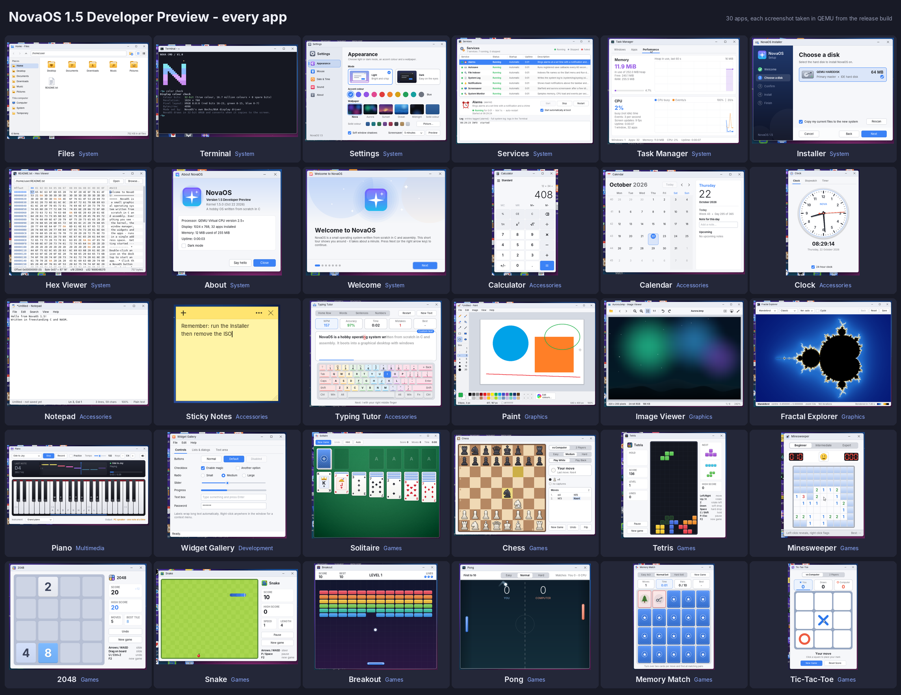

# NovaOS 2.5 Developer Preview - Release Notes

**Kernel version:** 2.5.0
**Download:** `NovaOS.iso` (bootable CD image, BIOS / GRUB)

NovaOS 2.5 is the biggest update yet: internet and a web browser, a new
way to install, save codes, a virus scanner and a new bottom of the screen.
As before, everything was tested in QEMU only, not yet on real VirtualBox.

## Install and boot
* **NovaOS Drive installation:** ISO boots open a setup screen after the
  splash. Pick a size (100 MB to 10 GB; sizes bigger than the disk are
  greyed out), then **Install** (progress bar with Cancel) or **Continue
  ISO**. When it finishes: "Your drive has been installed and ready to have
  files savable", a "How to start your drive" guide (VM / USB tabs) and
  Restart, which starts the installed drive.
* **Animated splash:** the Nova icon rises, shimmers rainbow, then a loading
  bar on installed drives. Settings > Styles: "No animation on splash screen".
* **/system** now holds the kernel, boot files, UI files (fonts, themes,
  wallpapers) and one file per app in /system/apps; NovaOS loads its UI
  from them.
* **"No drive found"** if the drive's top folders are deleted, and
  **"System requirement fail"** if the COS:// drive can't be read or a
  required bundle app is missing.

## Desktop
* **The taskbar is gone:** Start button at the bottom left with the running
  apps next to it, the rectangle with Settings, Welcome and Files in the
  middle (spinner while opening, glowing outline while open), and the time
  at the bottom right with "Developer version 2.5".
* **Games:** the ten games now live in one Games app.
* **Settings > Styles:** five screensavers (Nova Drop, Original, Bubbles,
  Bouncing App Logos, Lines) with live preview.
* **Screenshots** really save into Pictures: PrintScreen or **Ctrl+Alt+S**.
* **Every error plays the alert sound.**

## Internet
* **Networking:** Intel PRO/1000 (e1000) driver, DHCP, DNS, TCP, TLS 1.2 and
  1.3 with certificate checks, HTTP/1.1 (redirects, chunked, gzip), cookies.
  Terminal: `net`, `ping`, `nslookup`, `fetch`, `cookies`.
* **Web Browser:** tabs, address bar (sites or search), back / forward /
  reload / home, padlock and certificate warnings, bookmarks, history (can
  be turned off), find (Ctrl+F), zoom, view source, error pages. Pages:
  HTML, CSS (including flexbox, grid and positioning), PNG / JPEG / GIF /
  SVG, forms. No JavaScript.
* **Downloads:** download buttons and links save straight into Downloads;
  **Browser://Downloads** lists them (progress, Cancel, Retry, Show in
  folder) and works offline.

## HTML, CSS, JS, C and C++
* **HTML Viewer:** a new built-in app opens .html / .htm files saved on this
  computer (their default app; the Web Browser stays in Open With): the page
  with its stylesheets and pictures, links between local pages, Reload, Zoom,
  Open in Web Browser and File > Open. Web links open in the Web Browser.
* **File types:** CSS stylesheets, JavaScript files, C and C++ source files
  open in Notepad; HTML, CSS, JS, C and C++ files have their own icons.
* **Notepad code colours:** keywords, strings, comments, numbers and tags of
  HTML, CSS, JavaScript, C and C++ files, in light and dark mode.

## Safety and saving
* **SafetyShield:** scans every file every minute and every download right
  away, with seven risk levels (Safe to Severe), a list of scanned files and
  a notification when it finds a threat. It only reports; it never deletes.
* **OSaver:** turns your files, settings and wallpaper into a save code.
  ISO boots ask "Do you have a save file?" so a code brings everything back.

## Fixes
* Fractal Explorer no longer crashes with "x87 floating-point error"
  (Rainbow / dragging), and stops at "Maximum zoom reached".

## Known limitations
* Tested in QEMU only. In VirtualBox set the network adapter type to
  **Intel PRO/1000 MT Desktop** for internet.
* The browser has no JavaScript, so sites like ChatGPT's chat can't work, and
  its TLS is hobby code: don't type real passwords or bank details.

---

# NovaOS 1.5 Developer Preview - Release Notes

**Release date:** 22 October 2026
**Download:** [`NovaOS.iso`](NovaOS.iso) (about 10 MB, bootable CD image, BIOS / GRUB)
**Kernel version:** 1.5.0
**Target:** VirtualBox (*Other/Unknown*, 32-bit), 256 MB RAM, IDE, PS/2 mouse,
VBoxVGA or VMSVGA, ICH AC97 or SoundBlaster 16 audio. Tested in QEMU.

NovaOS 1.5 is the first public preview of NovaOS, a hobby operating system
written from scratch in C and NASM. It is a *Developer Preview*: complete
enough to use and explore, but not yet tested on real VirtualBox or on real
hardware. Setup instructions: [README.md](README.md#running-novaos-in-virtualbox-step-by-step).

## Highlights

* **A complete graphical desktop**: compositing window manager with shadows
  and rounded corners, snapping, Alt+Tab, taskbar with pins and clock, Start
  menu with search, desktop icons, light and dark themes, accent colours,
  wallpapers, notifications and a screensaver.
* **30 apps**: Files, Terminal, Settings, Services, Task Manager, Installer,
  Hex Viewer, About, Welcome, Calculator, Calendar, Clock, Notepad, Sticky
  Notes, Typing Tutor, Paint, Image Viewer, Fractal Explorer, Piano, Widget
  Gallery, Solitaire, Chess, Tetris, Minesweeper, 2048, Snake, Breakout, Pong,
  Memory Match and Tic-Tac-Toe.
* **Install to a hard disk**: the Installer writes NovaOS's own boot loader,
  the kernel and your files to an IDE disk. The installed system boots without
  the CD and saves your files automatically (two save slots, saved a few
  seconds after a change, every 60 s and at shut down).
* **Sound**: Intel ICH AC'97 and Sound Blaster 16 drivers with an 8-voice
  software synthesizer; the Piano plays real chords and several instruments.
* **Clean power handling**: shut down and restart from the Start menu; the
  ACPI power button (VirtualBox *ACPI Shutdown*) saves your files and powers
  off.

## What is in this release

### Desktop and shell
* Window manager: move, resize, maximize, minimize, snap to the screen edges,
  z-order and focus, Alt+Tab, Alt+F4, confirm-on-close for busy windows.
* Taskbar: Start button, pinned apps (right-click to pin / unpin), window
  buttons, volume / mute icon, clock with calendar pop-up.
* Start menu: recent items, apps by category, search across apps, files and
  commands, Run... and power buttons.
* Run dialog (Win+R) with autocomplete; opens apps, files, folders and
  commands.
* Desktop: icons for apps and files, context menus (Open, Open With, Rename,
  Delete, Properties, New Folder, New Text File, wallpaper, dark mode).
* File associations with user-changeable default apps, Open With and
  Properties dialogs; `assoc` command.
* Background services with a service manager: notifications, screensaver,
  alarms, autosave, file indexer, system log, system monitor; manage them in
  the Services app or with `service` / `systemctl`.
* First-run Welcome tour; boot splash; PrintScreen saves a screenshot.
* Icon library: every icon is drawn by NovaOS code at 16, 32 and 48 px.

### Terminal (NOVA CMD / V1.0)
* Banner with the big coloured N when a Terminal opens, `<cwd>%>` prompt.
* Over 70 commands: files (`ls`, `cp`, `mv`, `tree`, `find`, ...), text
  (`grep`, `wc`, `sort`, `head`, `tail`), system (`ps`, `free`, `df`,
  `disks`, `sync`, `uptime`, `dmesg`, `service`, `logs`, `sound`), `color
  check` for the display mode, `calc`, and toys (`neofetch`, `cowsay`,
  `fortune`, `matrix`, `sl`).
* Pipes, redirection, history, Tab completion, copy / paste, scrollback.

### Drivers and kernel
* 32-bit protected mode, GDT / IDT / PIC / PIT / FPU, paging for NULL-pointer
  and write protection, heap allocator, kernel panic screen with symbolised
  stack traces, COM1 serial log.
* VBE linear framebuffer (1024x768x32, 24-bit and 800x600 fallbacks,
  Bochs/BGA when booted without VBE).
* PS/2 keyboard (US layout, lock LEDs) and PS/2 mouse with wheel.
* ATA PIO disks on both IDE channels (master / slave, LBA28 / LBA48),
  including VirtualBox's way of reporting an empty channel (0x7F).
* Intel ICH AC'97, Sound Blaster 16, PC speaker; software mixer with soft
  limiter and click-free envelopes.
* ACPI: power off, power button (polled), ACPI mode enable.
* PCI enumeration, CMOS real-time clock.

### Boot
* GRUB menu: *NovaOS 1.5 Developer Preview*, *safe graphics 800x600*,
  *Boot from the first hard disk (installed NovaOS)*, *Reboot*.
* NovaOS's own two-stage hard-disk boot loader (MBR + stage 2: INT 13h
  extensions, A20, E820, VBE, Multiboot-compatible hand-off).

## Fixes made just before release
* VirtualBox: an empty IDE channel reads 0x7F instead of 0xFF; the disk probe
  and IDENTIFY now treat both as "no device" (a VM with only the CD used to
  log an unknown device), and a VM without a hard disk gets the Installer's
  "no hard disks" page.
* GRUB: the *safe graphics 800x600* entry now really boots in 800x600
  (`gfxpayload` is set after the `multiboot` command).
* ACPI power button: ACPI mode is enabled and the power button status is
  polled every 100 ms, so VirtualBox's *ACPI Shutdown* shuts NovaOS down
  cleanly and saves your files first.
* Keyboard lock LEDs follow Caps / Num / Scroll Lock and start from the BIOS
  state (VirtualBox syncs the host's lock keys from them, so this stops stray
  Caps Lock toggles).
* Sound: release times over 89 ms were cut short (32-bit overflow); a card
  that stops taking samples (e.g. audio output switched off in the VM) no
  longer leaves notes hanging; soft limiter instead of hard clipping.
* Settings -> About: the version line wraps inside the info panel.

## Verified for this release

The exact `NovaOS.iso` in the repository was booted through GRUB in QEMU
(`qemu-system-i386`, 256 MB, IDE, PS/2, std VGA):

* boots to the desktop with the Welcome tour, no errors in the serial log;
* Start menu, Terminal (NOVA CMD banner, `color check` shows 32-bit
  1024x768 set by GRUB VESA VBE), Files, Settings, Paint, Solitaire, Chess,
  Calculator, Services and Piano open and draw correctly; with an AC'97 card
  the boot log reports `audio: output Intel ICH AC'97, 48000 Hz, 8 voices`;
* the Installer installs onto a blank 64 MB disk in about 1.5 s;
* the disk boots on its own (no CD), a file written in the Terminal survives
  a power-button shut down and the next boot;
* the ACPI power button (`system_powerdown`) saves the files and powers the
  machine off, both from the CD and from the installed disk;
* the GRUB entries *safe graphics 800x600* (desktop in 800x600x32) and
  *Boot from the first hard disk* (starts the installed system via its own
  loader, with the CD still attached) work;
* all 30 apps were launched and screenshotted
  ([docs/screenshots/all-apps.png](docs/screenshots/all-apps.png)) without a
  kernel panic.

## Known limitations

* **Not yet tested on real VirtualBox** (or real PCs) - only in QEMU.
* No networking; no SATA/AHCI, NVMe, SCSI or USB (IDE disks and PS/2 input
  only); BIOS boot only (no UEFI); no Guest Additions (mouse capture,
  Right Ctrl releases it).
* Screen mode is fixed at boot (1024x768, or 800x600 in safe mode).
* Single address space in ring 0 with one CPU core: apps are built into the
  kernel; a crashing app stops the whole system, a blocking app freezes the
  desktop.
* The file system lives in RAM: on the live CD nothing is kept; on an
  installed disk it is saved as a snapshot (about 30 MB of files on a 64 MB
  disk).
* Sound output only; no Intel HD Audio; the PC speaker is silent in
  VirtualBox.
* Pictures are BMP (and PPM) only; US keyboard layout only; one user.

## Built with Claude

NovaOS was designed, written, tested and documented by Claude (Anthropic),
working as coding agents in Claude Code under the direction of the project's
owner. See [README.md](README.md#built-with-claude).
